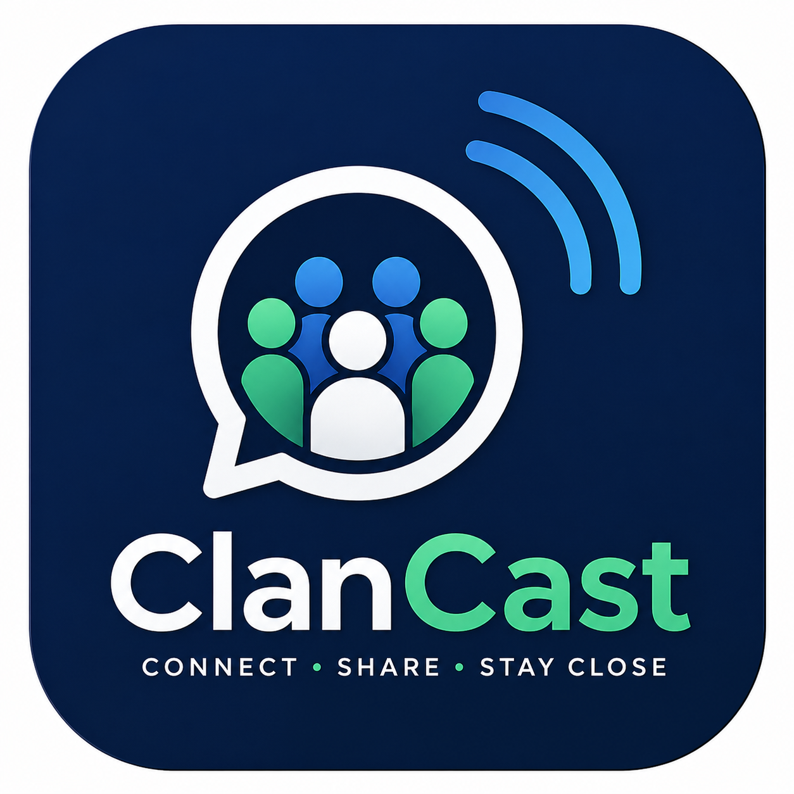

<p align="center">
  
</p>

# Clan Cast

**Connect, share, stay close.** Clan Cast is an Android app for sending careful, permission-based
text messages to a group of family and friends: a reminder about Sunday dinner, a holiday greeting,
an update to everyone at once. Each person receives an individual, personalized SMS from your own
phone number, and you review every message before anything is sent.

The app works entirely on the device. It has no accounts, no cloud service, and no server. It reads
your contacts, builds the messages, and sends them through Android's own SMS support.

## What it does

- **Distribution lists.** Build reusable lists from your device contacts. When a contact has several
  phone numbers, you choose the one to use for that list, and the app never sends to all of a
  contact's numbers.
- **Message templates.** Save reusable messages with simple personalization tokens, for example
  `Hi {firstName}, reminder that dinner is Sunday at 5.`
- **Review-first sending.** Every broadcast goes through a blocking preflight check before launch, and
  you see the final text for each recipient.
- **Controlled delivery.** Messages go out one at a time through a foreground service, with a
  pause, resume, and cancel control and a visible progress notification.
- **History.** Every broadcast is saved as a snapshot with per-recipient results, so you can see
  exactly what was sent to whom and what failed.

## How a broadcast works

1. **Pick a list and write the message**, either typed in or chosen from a saved template.
2. **Preflight.** The app resolves the list into a fixed set of recipients and checks:
   - the total number of entries and the number of unique phone numbers
   - **duplicate numbers**, where you choose to deduplicate, keep them, or go back and edit the list
   - **invalid numbers**, where you choose to exclude them, include them anyway, or go back
   - **missing values** for any token the message uses, which block launch until fixed
   - **unsupported tokens**, which also block launch
   - the final rendered message for every recipient
3. **Confirm.** You confirm the recipient count and your decisions on duplicates and invalid numbers.
4. **Send.** A foreground service sends the messages one at a time with a 3-second delay between
   them. A failure on one recipient is logged and the broadcast continues with the next.
5. **Review.** The history screen shows the result for each recipient.

### Snapshots

A broadcast is a snapshot. When it is created, the recipient list, phone numbers, personalization
values, and final message text are copied into the broadcast and become fixed. Later changes to
your contacts, lists, or templates never alter a broadcast that has been created. If the app is
interrupted during a send, it recovers safely from the stored snapshot.

### Template tokens

Templates use plain token replacement. The supported tokens are:

| Token | Value |
|---|---|
| `{firstName}` | First name |
| `{lastName}` | Last name |
| `{displayName}` | Contact display name |
| `{phoneNumber}` | The selected phone number |
| `{relationship}` | A relationship label you set in the app |
| `{nickname}` | A nickname you set in the app |

There are no conditionals, loops, or fallbacks. A token with a missing value is an error rather
than a silent blank, so nobody receives a message that reads "Hi ,". First name, last name,
relationship, and nickname can be edited per list member inside the app without changing your device
contacts.

### Safety limits

- A broadcast can have at most 50 recipients.
- Messages are sent strictly one at a time, with a fixed delay.
- Only SMS is used, with long messages automatically sent as multipart SMS. There is no MMS or RCS.
- The app tracks whether each message was handed off successfully. It does not track delivery
  receipts and does not retry automatically.
- A responsible-use notice appears when the app starts.

## Permissions

| Permission | Why |
|---|---|
| `READ_CONTACTS` | Browse contacts to build distribution lists |
| `SEND_SMS` | Send the messages |
| `FOREGROUND_SERVICE` and `FOREGROUND_SERVICE_DATA_SYNC` | Keep a broadcast running reliably with a progress notification |

If a permission is denied, the app explains what is missing and offers a way to grant it.

## Install

Clan Cast isn't on the Play Store. Each [GitHub release](https://github.com/jwkunz/Clan-Cast/releases/latest)
includes a debug APK, `clan-cast-vX.Y.Z-debug.apk`. Download it on your phone and tap it to install.
Android asks permission to install from your browser or file manager the first time, which is normal
for any app installed outside the Play Store. These are unsigned-by-you debug builds, so updating
from one build source to another may require uninstalling first.

## Building

Requirements: Android Studio, or the Android SDK with a JDK. The app supports Android 8.0 (API 26)
and later.

```sh
./gradlew assembleDebug     # build a debug APK
./gradlew installDebug      # install to a connected device
./gradlew test              # run the unit tests
```

The app is distributed by sideloading an APK and is not published on Google Play. Updates are
installed manually.

## CI and releases

[`.github/workflows/ci.yml`](.github/workflows/ci.yml) runs on pushes to `master`, tags and pull
requests. It checks that the version files agree, runs the unit tests, and builds the debug APK
(uploaded as a workflow artifact). Pushing a `v*` tag also publishes a GitHub release with the APK and deletes all earlier releases (the git tags stay).

The version lives in one file, `VERSION`. The Android `versionName` and `versionCode`
(`major*10000 + minor*100 + patch`) are derived from it.

```sh
node scripts/version.mjs set 1.0.2    # change the version
node scripts/version.mjs check        # verify everything agrees
git tag v1.0.2 && git push origin v1.0.2
```

CI refuses to release if the tag doesn't match `VERSION`. Update `CHANGELOG.md` before tagging. The
APK is a debug build; a Play Store upload would need a signed release build, which isn't set up.

## Tech stack

Kotlin, Jetpack Compose with Material, Room for local storage, coroutines and `StateFlow`, an
Android foreground service, and `SmsManager` for sending. The source is organized into `data`
(Room entities, DAOs, repositories, contacts access), `domain` (template parsing and rendering,
preflight validation, snapshot creation), `sms` and `service` (sending), and `ui` (Compose screens,
navigation, and view models). Unit tests cover template parsing and rendering, preflight
validation, phone number normalization, broadcast creation, and SMS callback tracking.

## Documentation

- [`requirements.md`](requirements.md): the full product requirements
- [`plan.md`](plan.md): the staged implementation plan
- [`CHANGELOG.md`](CHANGELOG.md): release notes

## Responsible use

Clan Cast is intended for thoughtful, permission-based communication. Please send responsibly,
respect recipients' preferences, and avoid unwanted or excessive messaging. Carrier charges may
apply to the messages it sends.

---

Copyright 2026 Numerius Engineering LLC. Current version: 1.0.2.
